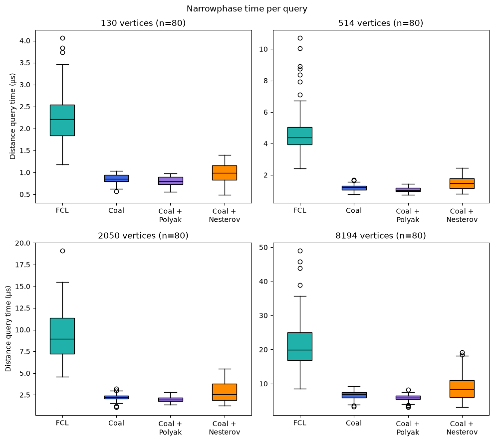
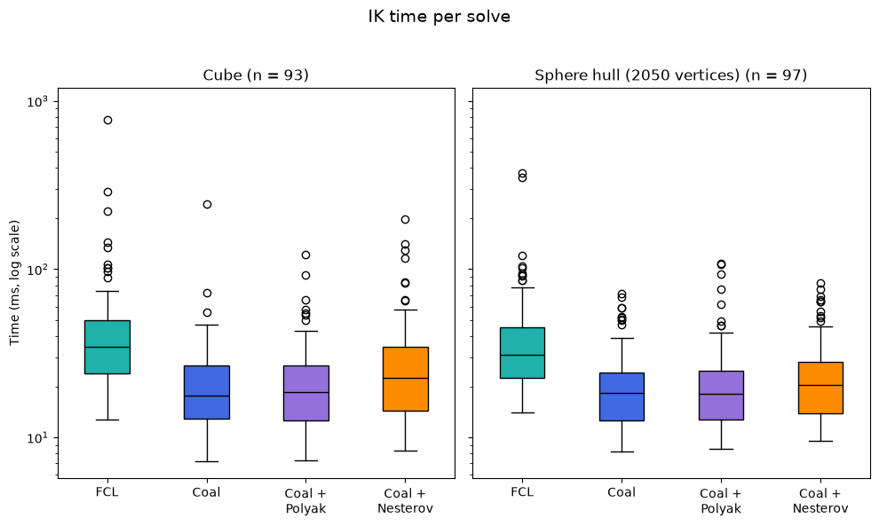

# Accelerated GJK in Drake

This fork integrates [Coal](https://github.com/coal-library/coal) (formerly HPP-FCL) into [Drake](https://drake.mit.edu)'s collision-query pipeline, with support for Coal's accelerated GJK variants from GJK++ ([Montaut et al., 2024](https://hal.science/hal-04070039/document)), and benchmarks their effect on narrowphase queries and full inverse kinematics problems.

**Author:** Aurora Gardner ([@rorygardner](https://github.com/rorygardner)), Optimization and Algorithmic Theory Lab, James Madison University \
**Advisor:** Zev Woodstock \
**Code:** branch [`gjk-acceleration`](https://github.com/OAT-Lab/drake/tree/gjk-acceleration) ([changes against Drake `master`](https://github.com/RobotLocomotion/drake/compare/master...OAT-Lab:drake:gjk-acceleration)) \
**Upstream discussion:** [RobotLocomotion/drake#24964](https://github.com/RobotLocomotion/drake/issues/24964)

## What it does

- Vendors Coal v3.0.4's narrowphase as a Drake internal dependency

- Routes signed distance, collision, and penetration queries through Coal for all shapes other than spheres and half-spaces, which are handled through Drake's existing pipeline. Broadphase goes through FCL (existing engine). 

- Exposes Coal's GJK variants (default, Polyak, Nesterov) and convergence criteria as engine options, selectable at runtime with an environment variable (`DRAKE_COAL_MODE=off/default/polyak/nesterov`), so existing Drake programs can be compared across backends without code changes. 

- Characterizes Coal's accuracy against known answers, and updates Drake's documented precision tables. 

    - This found two issues not covered by standard tests: `coal::Box` gives less precise distances than an equivalent convex box, and convex hulls above 32 vertices depend on a code path (hill-climbing over the hull's triangulation) that small test shapes never reach.

- Adds Drake's first narrowphase benchmark, comparing FCL with the three Coal variants.

## Results

**Narrowphase distance queries:** 

Distance calculations between convex hulls of 130-8194 vertices \
(80 configurations per size: 16 poses x 5 gaps from 1e-4 to 0.5 m). \
Median reduction in time per query relative to FCL:


| vertices       |Coal (default) | Coal + Polyak | Coal + Nesterov |
| :------------- | :-----------: | :-----------: | :-------------: |
| 130            |     60.30%    |     63.21%    |      55.51%     | 
| 514            |     72.67%    |     75.82%    |      69.74%     | 
| 2050           |     75.20%    |     78.36%    |      72.46%     | 
| 8194           |     67.36%    |     70.91%    |      59.46%     | 



**Full inverse kinematics:**

A KUKA iiwa7 using its full link meshes as collision geometry, with a minimum-distance constraint and one obstacle placed 1 mm from the arm, solved with IPOPT. Results are over the problems all four methods solved feasibly. \
The IK experiments are in a separate repository, [drake-ik-benchmark](https://github.com/OAT-Lab/drake-ik-benchmark), run against this fork. \
Median reduction in solve time relative to FCL:

| obstacle                    |Coal (default) | Coal + Polyak | Coal + Nesterov |
| :-------------------------- | :-----------: | :-----------: | :-------------: |
| Cube                        |     45.83%    |     45.69%    |      34.65%     | 
| Sphere hull (2050 vertices) |     45.14%    |     43.96%    |      34.23%     | 



Polyak acceleration shows the highest reduction agains FCL on isolated narrowphase queries, while in the full IK solve default GJK and Polyak perform about equally. \

**Ongoing research:** Investigating when Polyak and Nesterov accelerations perform better than plain GJK, with a focus on strongly convex shapes.

## Trying it
 
```bash
git clone https://github.com/OAT-Lab/drake.git
cd drake
git checkout gjk-acceleration
 
# Narrowphase benchmark (FCL vs. the three Coal variants)
bazel run //geometry/benchmarking:narrowphase_benchmark
 
# Any Drake program, run under a chosen backend
DRAKE_COAL_MODE=polyak bazel run //path/to:your_program
```

---

# Drake

Model-Based Design and Verification for Robotics.

Please see the [Drake Documentation](https://drake.mit.edu) for more
information.

